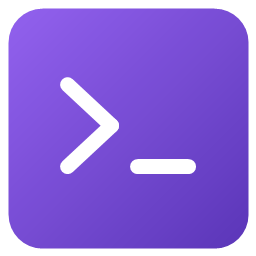
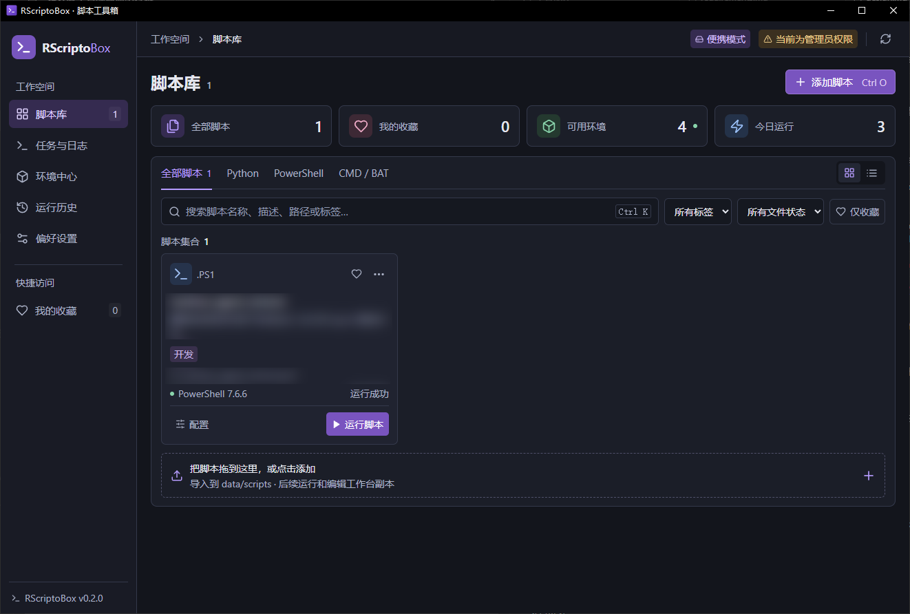
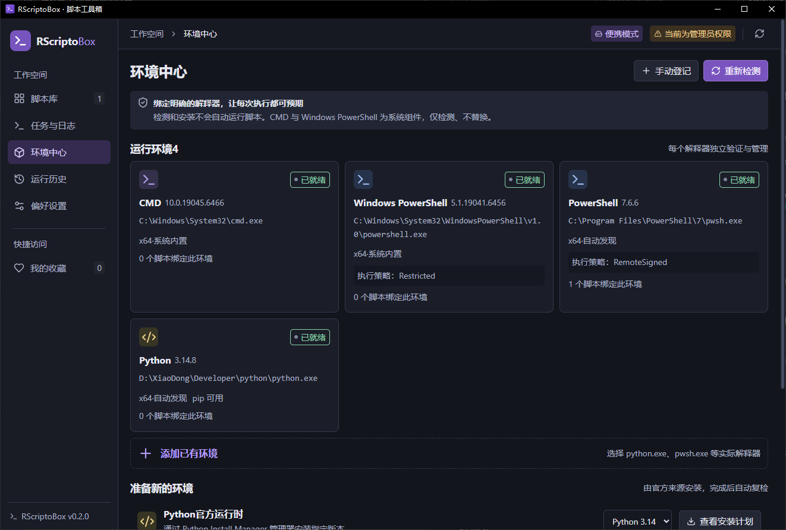
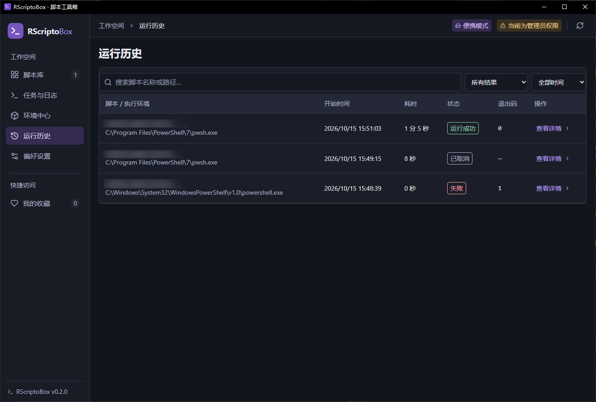

<div align="center">
  
  <h1>RScriptoBox</h1>
  <p>A Windows script workspace · Organize, configure and run interactively</p>
  <p>
    
    
    
    
    
  </p>
  <p>by <a href="https://github.com/rurikacy">Rurikacy</a> · <a href="README.md">简体中文</a></p>
  <p><a href="#-screenshots">Screenshots</a> · <a href="#-quick-start">Quick start</a> · <a href="#-building-from-source">Build</a> · <a href="SUPPORT.md">Support</a></p>
</div>

---

## 📖 Introduction

**RScriptoBox** is built with Rust, Tauri 2 and Vue 3 to manage CMD / BAT, PowerShell and Python scripts in one workspace. Import a workspace copy, bind an explicit interpreter, configure arguments and working directories, then run scripts in an interactive terminal and review their history.

The application has a dark purple interface and ships as a portable directory. Release users do not need Rust or Node.js; script interpreters and WebView2 are separate prerequisites. The current application UI is in Simplified Chinese; documentation is available in Chinese and English.

## 🖼️ Screenshots

<p align="center">
  
</p>

<table>
  <tr><th>Runtime center</th><th>Run history</th></tr>
  <tr>
    <td><a href="docs/screenshots/runtime-center.png"></a></td>
    <td><a href="docs/screenshots/run-history.png"></a></td>
  </tr>
</table>

These maintainer-provided screenshots show the actual 0.2.0 interface; script names and related details were already blurred in the supplied images. Click a thumbnail for the full image. Interpreter versions and paths belong to the pictured device.

## ✨ Features

| Feature | Description |
| --- | --- |
| **Script library** | Import or drop `.cmd`, `.bat`, `.ps1` and `.py`; search, filter, tag, favorite, and switch between cards and lists. |
| **Workspace copies** | Import into `data/scripts/<ID>/`; execution and editing use the copy, which survives deletion of the original entry file. |
| **Execution settings** | Bind interpreters and configure arguments, working directories, environment variables, timeouts and success exit codes. |
| **Interactive terminal** | ConPTY + xterm.js supports typing, `input()`, `Read-Host`, `pause` and Ctrl+C; a separate system console is also available. |
| **Runtime center** | Detect or register interpreters; review installation plans for Python / PowerShell 7 and recheck after installation. |
| **Python dependencies** | Create an isolated venv and explicitly select a `requirements.txt` to install. |
| **Tasks and history** | View live output, status, duration and exit codes; replay or export logs and stop managed process trees. |
| **Display and data** | Default 16px body text, selectable 14 / 16 / 18 / 20px sizes and DPI scaling; portable data, database backup and restore. |

## 📥 Quick Start

1. Download `RScriptoBox-0.2.0-windows-x64-portable.zip` from [Releases](https://github.com/rurikacy/RScriptoBox/releases/latest); ZIPs are not stored in the source tree.
2. Extract to a writable local directory. Keep `portable.flag` beside `RScriptoBox.exe`, then launch the executable.
3. Open **环境中心** (Runtime center) to detect interpreters, review an installation plan, or register an interpreter path manually.
4. Add a script in **脚本库** (Script library), bind a runtime in **配置** (Configure), then select **运行脚本** (Run script).
5. Try `examples/interactive.py`, `interactive.ps1` or `interactive.cmd` to explore interactive input.

**Requires Windows 10 22H2 / Windows 11 x64 and [Microsoft Edge WebView2 Evergreen Runtime](https://developer.microsoft.com/microsoft-edge/webview2/).** WebView2, Python and PowerShell 7 are not bundled. The application is unsigned. Local validation covers Windows 10; Windows 11 still needs testing on a real device. See the [validation record](docs/verification.md) (Chinese).

CMD and Windows PowerShell 5.1 are system components; the application detects but does not replace them. Installation uses WinGet or the official Python Install Manager. Plans show sources and possible system interaction; UAC, network access and enterprise policies can affect completion.

## 🧭 Usage and Portability

### Execution and input

Enter arguments separately; empty arguments are preserved. A script needs trust confirmation before its first run and after content changes. Click the built-in terminal to type. Ctrl+C is handled by the script; **强制停止** (Force stop) terminates the managed process tree. Select **返回实时** (Return to live) before typing while viewing a running task's saved log.

The terminal uses UTF-8 and merges stdout / stderr. Exported logs retain terminal control sequences; the copy button provides plain text from the screen and scrollback buffer. Password hiding depends on the script's input method, and ordinary input echo may be recorded in logs.

### Workspace copies

Import copies the entry script only, not neighboring resources or dependencies. Use **打开所在目录** (Open containing folder) to place related files next to the copy; this folder is the default working directory. Changes to the original do not synchronize automatically. **重新导入副本** (Reimport copy) creates a new version and retains the old copy. Removing a library record deletes neither the original nor the workspace copy.

### Upgrading and moving

- **Upgrade in place:** exit and back up the entire old directory. Replace its EXE with the new one, keeping `portable.flag` and `data` to avoid changing existing venv paths.
- **Move to another path or device:** exit, then copy the entire portable directory, including `data`. Script paths and working directories inside `data/scripts` are stored relatively. Detect and bind interpreters again on the destination, and recreate Python venvs.
- **Migrate older data:** 0.2.0 backs up the database and copies accessible legacy entry scripts into the workspace. Missing originals or failed copies need reimporting. The database is upgraded to schema 2; reverting requires the complete pre-upgrade directory backup.
- **Backup scope:** database backups do not contain script files and do not replace a full `data` backup. External working directories, absolute path arguments and system dependencies require configuration on the destination.

Without `portable.flag`, a standalone EXE uses the current user's application data directory by default; `--portable` also enables portable mode. See [Support](SUPPORT.md) for troubleshooting and database recovery.

## 🔧 Building from Source

Requires Windows, Rust stable with the MSVC toolchain, Visual Studio C++ Build Tools / Windows SDK, Node.js 24 and WebView2. `package-lock.json` and `src-tauri/Cargo.lock` pin npm and Rust dependencies.

```powershell
npm ci
npm run tauri dev

# Checks and tests
npm test
npm run build
cargo fmt --manifest-path src-tauri/Cargo.toml -- --check
cargo clippy --manifest-path src-tauri/Cargo.toml --all-targets -- -D warnings
cargo test --manifest-path src-tauri/Cargo.toml --lib -- --test-threads=1
cargo test --manifest-path tests/runner/Cargo.toml -- --test-threads=1

# Portable application and SHA256; process tests need the relevant interpreters
pwsh -File scripts/package-portable.ps1
```

Outputs go to `release/`. Frontend assets are embedded in the EXE; release users do not need a development server. Browser previews use sample data and cannot perform desktop operations. After dependency updates, run `node scripts/generate-notices.mjs` to refresh license notices.

## 🗂️ Project Structure

```text
RScriptoBox/
├── src/                       # Vue interface and interactive terminal
├── src-tauri/                 # Rust backend, Windows processes and storage
├── examples/                  # Basic and interactive samples
├── tests/runner/              # Native Windows process tests
├── scripts/                   # Build, packaging and license inventory generation
├── docs/                      # Requirements, design, validation, images and licenses
├── .github/                   # CI and issue / PR templates
├── README.md / README_EN.md
├── LICENSE / THIRD-PARTY-NOTICES.txt
└── CONTRIBUTING.md / SECURITY.md / SUPPORT.md
```

## ⚠️ Boundaries and Compatibility

- This is a manager for trusted scripts, **not a sandbox**. Scripts inherit the application's privileges. Review scripts and use elevation only when needed.
- CMD paths and arguments use a conservative character set; parentheses, percent signs, exclamation marks, quotes and other unsupported characters are rejected explicitly. Scripts can read complex input from a configuration file.
- The application does not permanently change PowerShell execution policy. RemoteSigned or Bypass can be explicitly selected for a single process; enterprise group policy still takes precedence.
- Installers may continue outside the application; cancellation does not guarantee rollback. Force-stopping scripts may interrupt writes.
- The [validation record](docs/verification.md) lists completed checks and untested scenarios; it does not certify every system or display configuration.

## 🤝 Contributing and Feedback

Read [Contributing](CONTRIBUTING.md), the [Code of Conduct](CODE_OF_CONDUCT.md) and [Support](SUPPORT.md). Use [Issues](https://github.com/rurikacy/RScriptoBox/issues) for feedback. Follow the [Security policy](SECURITY.md) for vulnerabilities; do not post sensitive scripts or logs publicly.

[Requirements](docs/requirements.md) · [Technical design](docs/design.md) · [Release preparation](GITHUB_PREPARATION.md) (Chinese)

## 📄 License

Project-owned source, documentation and application icons use [The Unlicense](LICENSE). Third-party libraries, UI icons and dependency materials retain their own licenses; the project's public-domain dedication does not replace them. Sources, versions and original license texts are in [Third-party notices](THIRD-PARTY-NOTICES.txt) and the [dependency license inventory](docs/licenses/dependencies.txt). External interpreters, installers and WebView2 are not distributed in this portable package.
